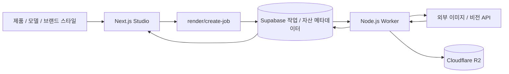

# Zeriv

브랜드의 시각적 스타일을 구조화하고, 제품 사진과 AI 모델을 조합해 콘텐츠 이미지를 만드는 웹 서비스입니다.
개발 기간은 **3개월**입니다. 이 저장소는 Zeriv의 웹 앱과 이미지 생성 워커를 독립적으로 정리한 비공개 소스 스냅샷입니다.

## 해결하려는 문제

브랜드 콘텐츠를 반복 제작할 때 색감·라이팅·배경 같은 시각적 기준을 매번 새로 설명해야 하고, 제품과 모델을 바꾸면 결과의 일관성을 유지하기 어렵습니다. Zeriv는 브랜드 스타일을 재사용 가능한 데이터로 저장하고, 제품·모델·스타일 선택에서 생성 결과 관리까지 연결합니다.

## 주요 기능과 구현

- **브랜드 스타일 관리:** 색상 팔레트, 질감, 라이팅, 장면, 무드와 소품 정보를 구조화합니다. 브랜드 정보와 레퍼런스를 분석해 스타일을 구성하고, 스타일 시트와 생성 프롬프트에 반영합니다. 여기서 스타일 추출은 LLM 기반 파라미터 구성으로, 모델 가중치를 재학습하는 fine-tuning을 의미하지 않습니다.
- **Studio 이미지 생성:** 제품 단독 이미지와 제품+모델 이미지를 생성하는 경로를 제공합니다. Quick 모드에는 상품 카테고리와 이미지 형식에 따른 패턴 선택이 있습니다.
- **비동기 작업:** API가 입력·접근 권한·생성 이용권을 확인하고 DB에 작업을 등록합니다. Node.js 워커는 `claim_next_job` RPC로 작업을 선점하며 동시 실행 수와 오래된 처리 작업의 재시도를 관리합니다.
- **파일과 결과 관리:** 원본·생성 파일은 S3 호환 Cloudflare R2에, 작업 상태와 자산 메타데이터는 Supabase에 저장합니다. 자산 조회와 다운로드는 앱 경로를 통해 연결됩니다.
- **서비스 기능:** 브랜드·조직 접근 제어, 구독·생성 팩, 결제·이메일 연동 코드가 포함됩니다. 외부 계정 설정과 기능별 통합 검증이 별도로 필요합니다.



## 기술 구성

Next.js 16 · React 19 · TypeScript · Tailwind CSS 4 · next-intl · Supabase Auth/Postgres · Node.js Worker · Cloudflare R2/S3 SDK · Gemini/OpenAI/xAI/Anthropic/FAL 연동 코드

## 코드 읽기 순서

| 관심 영역 | 경로 |
| --- | --- |
| Studio 화면 | `web/src/app/studio/` |
| 스타일 데이터·프롬프트·시트 | `web/src/lib/style/` |
| 브랜드별 스타일 API | `web/src/app/api/brands/[id]/styles/` |
| 현재 이미지 생성 요청 | `web/src/app/api/render/create-job/route.ts` |
| 이미지 생성 워커 | `web/scripts/worker.mjs` |
| 작업 선점 SQL | `web/supabase/migrations/20260424_claim_next_job_rpc.sql` |
| R2 업로드·다운로드 | `web/src/lib/r2.ts` |
| 생성 이용권 소비·보상 | `web/src/lib/packConsumption.ts` |

## 로컬 준비

Node.js 20.9 이상과 npm이 필요합니다. 아래 예시는 PowerShell 기준입니다.

```powershell
cd web
npm ci
Copy-Item .env.example .env.local
# .env.local에 별도로 준비한 테스트용 프로젝트 설정을 입력합니다.
npm run dev
```

브라우저는 `http://localhost:3000`으로 접속합니다. 인증·데이터 기능에는 본인 소유의 Supabase 테스트 프로젝트가 필요합니다. 서버 비밀 키는 `NEXT_PUBLIC_` 변수에 넣지 않습니다.

이미지 생성까지 실행하려면 R2 버킷과 사용 경로에 해당하는 AI 제공자 API 키가 필요합니다. 실제 요청은 **유료 사용량을 발생시킬 수 있습니다.** 웹과 워커가 같은 DB 및 `JOB_SOURCE`를 사용하도록 설정한 뒤 별도 터미널에서 실행합니다.

```powershell
cd web
npm run worker:run
```

워커는 시작하면 대기 작업을 처리할 수 있습니다. `.env.example`은 실서비스 자격증명 없이 테스트용 값을 채우기 위한 템플릿입니다. 결제·이메일 기능은 별도 테스트 계정으로 설정합니다. 프런트엔드 사업자 정보와 연락처는 예제값입니다.

### 데이터베이스 준비 범위

`web/sql/`에는 기존 스키마·변경 SQL, `web/sql/brand-migrations/`에는 브랜드 파이프라인 SQL, `web/supabase/migrations/`에는 후속 마이그레이션이 포함됩니다. 이는 스키마 설계 기록이며 **빈 DB에서 순서대로 실행 가능한 통합 설치 절차로 검증된 상태는 아닙니다.** 파일 사이의 선행 테이블·함수·정책 의존성과 중복 변경을 검토한 후 별도 테스트 DB에 적용해야 합니다. 운영 DB, 계정, 고객 데이터와 배포 설정은 제공하지 않습니다.

## 검증과 현재 제한

```powershell
npm run typecheck      # 원본 검사 범위: 기존 Jest 테스트 2개의 오류가 남아 있습니다.
npm run typecheck:app  # 해당 레거시 테스트 2개만 제외한 앱 소스 추가 검사
npm run build
node --check scripts/worker.mjs
```

- `npm ci --ignore-scripts --no-audit --no-fund`, 앱 타입검사, 워커 3개 파일의 구문검사를 통과했습니다. 자격증명 없이 수행한 Next.js 프로덕션 빌드도 완료됐으며, 블로그 sitemap 조회는 Supabase 설정 누락으로 생략됐습니다. 빌드 성공이 생성·결제 기능의 실행 검증을 의미하지는 않습니다.
- 원본 `tsconfig.json`은 보존했습니다. 기존 Jest 테스트 2개는 러너·타입 의존성이 구성되지 않았고 일부 fixture 타입도 현재 계약과 달라 전체 타입검사가 실패합니다. 테스트 소스는 보존하며 앱 검사 결과와 구분합니다.
- 현재 설명 대상은 이미지 생성 경로입니다. `/api/render-jobs`와 `/api/internal/pipeline` 등 레거시 경로는 `410`을 반환하며, 남아 있는 영상 파이프라인 코드 전체가 작동한다고 보장하지 않습니다. 외부 GPU 서브 워커와 모델 가중치는 포함하지 않습니다.
- 새 테스트 DB에서 인증→생성→결과 저장까지의 통합 실행, 결제와 이메일 발송은 이 스냅샷 정리 과정에서 수행하지 않았습니다.
- `public/studio-showcase` 등 정적 이미지는 UI 설명을 위한 데모 자산입니다. 실사용 지표나 실제 고객 생성 결과의 증거가 아닙니다. 대형 랜딩 영상과 별도 실험 이미지 일부는 제외되어 해당 미디어가 표시되지 않을 수 있습니다.
- 빌드 중 `next/font/google`의 폰트 다운로드에는 네트워크 연결이 필요합니다.

## 라이선스와 자산

이 스냅샷에 새로운 오픈소스 라이선스를 부여하지 않았습니다. 패키지와 외부 서비스·모델·자산은 각각의 라이선스와 이용 조건을 따릅니다. 포함된 데모 이미지를 별도 재배포할 때에는 출처와 사용 권한을 확인해야 합니다.
