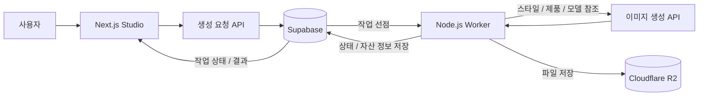

# Zeriv


**브랜드 스타일을 담은 AI 콘텐츠 이미지 제작 서비스**

Zeriv는 브랜드의 색감, 질감, 라이팅과 장면을 저장하고 제품 사진·AI 모델과 조합해 이미지를 만드는 웹 서비스입니다. 매번 긴 프롬프트를 작성하는 대신, 저장한 스타일과 자산을 선택해 콘텐츠를 제작할 수 있습니다.

[주요 기능](#주요-기능) · [시작하기](#시작하기) · [개발 가이드](docs/DEVELOPMENT.md) · [검증 기록](docs/VALIDATION.md)

## 주요 기능

| 기능 | 설명 |
| --- | --- |
| 브랜드 스타일 | 색상, 질감, 라이팅, 장면, 무드와 소품 정보를 구조화하고 재사용합니다. |
| 스타일 시트 | 브랜드 정보와 레퍼런스를 바탕으로 스타일을 구성하고, 생성에 사용할 프롬프트와 참조 이미지에 반영합니다. |
| Studio | 제품 단독 이미지 또는 제품과 모델을 조합한 이미지를 생성합니다. |
| Quick 모드 | 상품 카테고리와 이미지 형식에 맞는 패턴을 선택해 생성 요청을 구성합니다. |
| 작업 큐 | 생성 요청을 비동기로 처리하고 진행 상태와 결과를 관리합니다. |
| 자산 관리 | 제품·모델·스타일과 생성 결과를 저장하고 조회·다운로드합니다. |
| 워크스페이스 | 브랜드·조직 접근 권한과 구독·생성 이용권을 관리합니다. |

## 사용 흐름

1. 브랜드 정보를 입력하고 스타일을 구성합니다.
2. 제품 사진과 사용할 모델·스타일을 선택합니다.
3. Studio에서 생성 요청을 등록합니다.
4. 작업 상태를 확인하고 완성된 이미지를 다운로드합니다.

스타일은 프롬프트와 참조 이미지로 생성에 반영합니다. 별도 모델 학습이나 fine-tuning을 사용하는 방식은 아닙니다.

## 아키텍처



- **웹 앱:** 인증, 브랜드·자산 선택, 생성 요청, 결과 조회를 담당합니다.
- **생성 API:** 입력값·접근 권한·이용권을 확인한 뒤 작업을 등록합니다.
- **워커:** `claim_next_job` RPC로 작업을 선점하고 동시 실행 수와 오래된 처리 작업의 재시도를 관리합니다.
- **저장소:** 파일은 R2에, 작업 상태와 자산 메타데이터는 Supabase에 저장합니다.

## 기술 스택

| 영역 | 기술 |
| --- | --- |
| Frontend | Next.js 16, React 19, TypeScript, Tailwind CSS 4, next-intl |
| Backend | Next.js Route Handlers, Node.js Worker |
| Database / Auth | Supabase PostgreSQL, Supabase Auth |
| Storage | Cloudflare R2, AWS S3 SDK |
| AI 연동 | Gemini, OpenAI, xAI, Anthropic, FAL |

AI 제공자는 기능과 생성 경로에 따라 선택적으로 사용합니다.

## 시작하기

### 준비 사항

- Node.js **20.9 이상**, npm
- 별도로 구성한 Supabase 프로젝트와 DB 스키마
- 이미지 생성용 R2 버킷 및 사용할 AI 제공자의 API 키

> 저장소의 SQL은 개발 중 사용한 스키마·변경 기록입니다. 빈 DB에 순서대로 적용하는 통합 설치 절차는 검증되지 않았으므로, 먼저 [DB 준비 안내](docs/DEVELOPMENT.md#데이터베이스)를 확인해 주세요. 외부 서비스 설정을 완료해야 인증과 이미지 생성 기능을 실행할 수 있습니다.

### 웹 앱 실행

```bash
git clone https://github.com/Dav3411/zeriv.git
cd zeriv/web
npm ci
cp .env.example .env.local
```

[환경 변수 템플릿](web/.env.example)을 참고해 `.env.local`을 설정합니다. Windows PowerShell에서는 `cp` 대신 `Copy-Item .env.example .env.local`을 사용할 수 있습니다.

```bash
npm run dev
```

브라우저에서 [http://localhost:3000](http://localhost:3000)에 접속합니다. `/studio`는 로그인·브랜드 상태에 따라 해당 Studio로 이동하는 진입 경로입니다.

### 이미지 생성 워커 실행

별도 터미널의 `zeriv/web` 디렉터리에서 실행합니다.

```bash
npm run worker:run
```

웹 앱과 워커는 같은 DB와 `JOB_SOURCE`를 사용해야 합니다. 워커는 대기 작업을 처리하며 외부 AI API 사용 요금이 발생할 수 있습니다. 자세한 설정은 [개발 가이드](docs/DEVELOPMENT.md)를 참고해 주세요.

## 프로젝트 구조

```text
zeriv/
├── docs/                       # 개발 환경과 검증 기록
└── web/
    ├── src/
    │   ├── app/
    │   │   ├── [brandName]/studio/  # 브랜드별 Studio
    │   │   └── api/             # 브랜드·스타일·생성 API
    │   ├── components/         # 공통 UI와 상태 관리
    │   └── lib/
    │       ├── style/          # 스타일 데이터·프롬프트·시트
    │       └── r2.ts           # 파일 업로드·다운로드
    ├── scripts/worker.mjs      # 이미지 생성 워커
    ├── public/                # 정적 이미지와 데모 자산
    ├── sql/                   # 스키마·변경 SQL
    └── supabase/migrations/    # 후속 마이그레이션
```

## 개발 명령어

`web` 디렉터리에서 실행합니다.

| 명령어 | 용도 |
| --- | --- |
| `npm run dev` | 개발 서버 |
| `npm run worker:run` | 이미지 생성 워커 |
| `npm run typecheck:app` | 앱 소스 타입 검사 |
| `npm run build` | 프로덕션 빌드 |
| `npm run start` | 빌드한 웹 앱 실행 |

`typecheck:app`은 레거시 테스트 2개를 제외합니다. 전체 타입 검사와 외부 서비스 통합 실행의 확인 범위는 [검증 기록](docs/VALIDATION.md)에 정리했습니다.

## 관련 문서

- [개발 환경·환경 변수·DB 준비](docs/DEVELOPMENT.md)
- [검증 결과와 알려진 제한](docs/VALIDATION.md)
- [이미지 생성 요청 API](web/src/app/api/render/create-job/route.ts)
- [스타일 처리 모듈](web/src/lib/style/)
- [이미지 생성 워커](web/scripts/worker.mjs)

## 개발 정보

- **기간:** 3개월
- **팀:** 2인
- **최성원:** 서비스 기획, 프론트엔드·백엔드 전반 구현 및 시스템 구성
- **GitHub:** [@Dav3411](https://github.com/Dav3411)

## 라이선스

이 저장소에는 별도 오픈소스 라이선스를 지정하지 않았습니다. 의존 패키지와 외부 서비스·모델·자산은 각각의 라이선스 및 이용 조건을 따릅니다.
